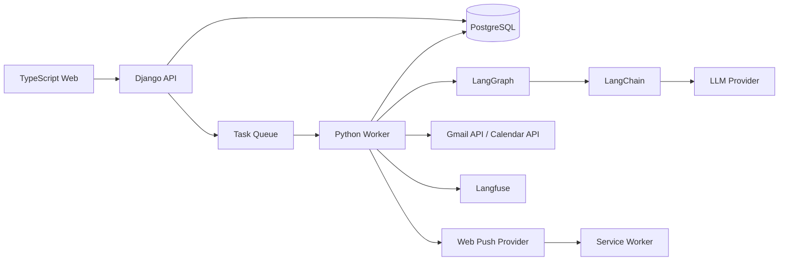

# jobMate 시스템 상세설계서

| 항목 | 값 |
|---|---|
| 문서 버전 | 1.0.0 |
| 기준일 | 2026-11-19 |
| 구현 기준 | Django 모듈형 모놀리스, PostgreSQL, 비동기 워커 |
| 관련 문서 | 기본기획서, 기능별 상세설계서, API 설계서, DB 설계서 |

## 문서 이력

| 버전 | 기준일 | 수정 내용 |
|---|---|---|
| 1.0.0 | 2026-11-19 | 최초 작성, 6계층 하네스 런타임 원칙 반영 |

## 1. 아키텍처

## 2. 모듈 책임

| 모듈 | 책임 |
|---|---|
| identity | 사용자, 조직 멤버십, 역할, 세션 |
| workflow | 템플릿, 버전, 입력 검증, 실행 생성 |
| orchestration | LangGraph 정의·상태 전이·재개, 단계 결과 |
| integrations.google | OAuth 연결, Gmail 검색, Calendar 이벤트 생성 |
| notifications | 푸시 구독, 예약·전송·재시도·클릭 경로 |
| observability | 실행 ID, Langfuse trace 연계, 비용·오류 지표 |
| audit | 권한·연결·자동 등록·승인 이력 |

## 3. Gmail 일정 자동화 흐름

1. 연결된 계정별 Gmail 감지 작업을 스케줄링한다. 초기 구현은 주기 검색(polling)으로 시작한다.
2. 검색은 설정된 시간 범위와 처리 이력 이후의 메일로 제한한다.
3. 메일 파서와 일정 추출 에이전트는 구조화된 후보를 반환한다. 모델 출력은 스키마·날짜·시간대 검증을 통과해야 한다.
4. 정책 검증기는 일정 확정성, 반복 여부, 참석자, 원본 ID 및 기존 처리 여부를 확인한다.
5. 유효한 신규 일정은 Calendar API로 생성한다. idempotency key 및 DB unique constraint로 중복을 방지한다.
6. 이벤트 ID를 저장한 뒤 알림 작업을 생성한다. 푸시 payload의 URL은 원본 Gmail 메시지 링크다.
7. 모호한 후보는 `needs_review`, 인증 철회는 `connection_error`, 일시 오류는 재시도 상태로 남긴다.

Google API 성공 후 DB 저장이 실패할 수 있으므로, 재처리 시 Calendar 이벤트 ID/extendedProperties 또는 저장한 idempotency key를 조회해 중복을 방지한다. 일정 삭제·수정 동기화는 MVP 범위에 포함하지 않는다.

## 4. 실행 상태

`queued → running → waiting_review | completed | failed | cancelled`

일정 자동화 단계 상태는 `discovered → extracted → validated → calendar_created → notification_queued → notified`를 사용한다. `needs_review`, `duplicate`, `connection_error`, `retry_wait`는 보조 상태다.

## 5. 신뢰성·보안

- API 요청은 실행 레코드를 만든 뒤 큐에 전달하며, 큐 중복 전달을 고려해 작업을 멱등하게 만든다.
- 단계별 timeout, 제한 재시도, exponential backoff 및 dead-letter 상태를 둔다.
- OAuth access/refresh token은 KMS 또는 애플리케이션 암호화 키로 암호화한다.
- Google API 호출과 Calendar 생성 권한은 통합 모듈에서만 수행한다.
- 서비스 워커는 알림 클릭을 검증된 Gmail URL 또는 정해진 도메인의 링크로만 이동시킨다.
- Langfuse에는 trace ID, 단계, 모델, 사용량, 오류 코드를 보내고 메일 본문 및 토큰은 마스킹한다.

## 6. 운영 관찰

필수 지표: 큐 대기 시간, 실행 소요 시간, Gmail API 오류율, 추출 실패율, Calendar 생성·중복률, 푸시 전송률, 워커 재시작 수, 토큰·비용. 알림 실패는 일정 생성을 롤백하지 않고 재시도한다.

## 7. 하네스 런타임 계약

| 계층 | 런타임 책임 | 구현 기준 |
|---|---|---|
| 가이드 | 템플릿/에이전트 버전과 실행 지시 고정 | workflow version과 prompt/config hash를 run에 저장 |
| 센서 | 산출물·권한·외부 효과의 결정적 검증 | schema validator, timezone validator, RBAC, idempotency constraint |
| 루프 | 상태 있는 단계 실행 | LangGraph checkpoint, 최대 재시도·시간·token/tool budget |
| 메모리 | 중단 후 복구 | PostgreSQL에 run checkpoint와 outbox 저장, 재개 cursor 영속화 |
| 권한·예산 | tool capability enforcement | 각 실행에 연결 사용자와 허용 scope를 묶고 서버 통합 계층에서 재검증 |
| 관찰가능성 | 추적·비용·운영 경보 | trace ID, step ID, prompt/config version, tool event, usage, 결과 ID 저장 |

LLM은 도구 호출 의도를 제안할 수 있지만 실행 허용 여부는 서버 정책이 결정한다. LangGraph checkpoint는 실행 메모리이며, 감사 기록과 업무 원장은 PostgreSQL 도메인 테이블을 기준으로 한다. Langfuse에 메일 본문/토큰을 보내지 않는다.

### 7.1 Gmail·Calendar 작업의 센서 순서

`mail access scope → 입력 크기/HTML 정리 → 일정 구조화 출력 검증 → 날짜·timezone·종료시각 검증 → 신뢰/모호성 정책 → 조직·연결 권한 → 멱등 키 확보 → Calendar write → event ID 확인 → DB commit/outbox → push enqueue`

어느 센서라도 실패하면 그 뒤의 부작용 단계는 실행하지 않는다. Calendar 생성 응답이 불명확한 경우에는 marker로 이벤트 존재를 확인하기 전 재생성을 시도하지 않는다.

### 7.2 정지와 복구

재시도·시간·호출·비용 상한에 도달하거나 외부 쓰기 급증, 반복 오류, 권한 이상이 발생하면 해당 실행 또는 연결의 신규 외부 쓰기를 일시 중단한다. checkpoint와 미완료 작업을 보존하고, 운영자 또는 사용자가 확인한 뒤 재개한다. 자동 재개는 외부 부작용 중복이 없음을 검증할 수 있을 때만 허용한다.
